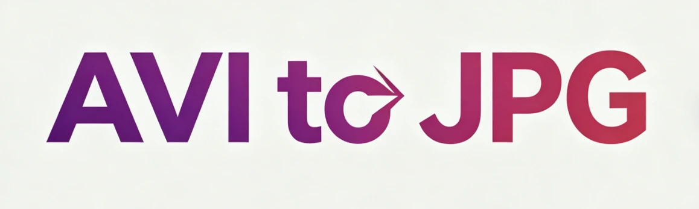
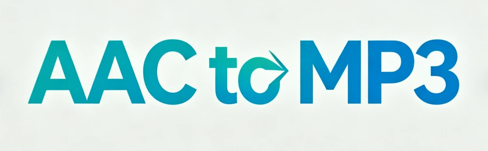

# Converter Tool

[Visit Converter Tool](https://convertertool.net/)

## Explore the Website

Converter Tool is a free online converter for video, image, JSON, audio, and everyday file tasks. Use it for popular workflows such as video to JPG, PNG to JPG, JPG to WEBP, JSON formatting, XML parsing, and more. Supported tools are designed to be fast, easy to use, and privacy-friendly, with local browser processing available whenever possible.

Converter Tool brings together free online tools for video, image, JSON, audio, archive, and unit conversion in one consistent interface. You can convert video to JPG, turn PNG into JPG, compress JPG to WEBP, format JSON, compare text, parse XML, and handle other common tasks without installing extra software. Many tools process supported files locally in your browser, preferring local GPU acceleration for heavier media work and falling back to local CPU when hardware acceleration is unavailable. That helps protect privacy, reduce unnecessary uploads, and make everyday conversions faster from input to download.

Converter Tool is designed to be accessible from any modern browser. There is no account to create, no download to manage, and no complicated onboarding to slow you down. You open the page, choose a tool, and get results quickly.

This approach is especially helpful when you are in the middle of development, content production, or data cleanup and you just need a conversion without switching contexts. The layout stays focused on the essentials: paste or upload input, run the action, and export or copy the output.

Each tool keeps the same interaction pattern, so once you learn one page you can move confidently through the rest of the site. For a new project or a quick one-off task, free online tools should be straightforward, and that is the experience this site aims to deliver.

Privacy matters, especially when you are working with logs, configuration files, API responses, documents, or media you do not want to share. Converter Tool prioritizes local, in-browser processing whenever possible, so your data can stay on your device and out of the server path.

When a supported tool can use local hardware acceleration, the site prefers the browser or device GPU for speed. If the browser cannot expose a GPU path, conversion falls back to the local CPU instead of silently moving the job to a remote server.

## Plan Your Visit

When you are formatting JSON, cleaning HTML, converting images for a website, compressing video, or extracting an archive, you should not need to wonder where your files go. A privacy-first approach is not a single feature, it is a product principle that influences defaults, UI, and the way tools are implemented.

Most people do not need one perfect converter. They need a set of practical tools that solve everyday problems. Converter Tool focuses on common formats and workflows: JSON formatting, parsing, and cleanup for developers; HTML formatting for readable markup; image conversions for preparing assets and thumbnails; and video conversions for compatible playback across platforms.

It also includes archive utilities for packaging, extraction, and sharing, plus everyday calculators such as unit conversions and base conversions. These categories cover many typical needs: web development, data preparation, content publishing, education, and general productivity.

A good converter should feel predictable. Converter Tool keeps interactions lightweight with clear inputs and outputs, sensible defaults, and practical actions like copy-to-clipboard, file upload, and readable formatting.

Speed is not only about computation; it is also about reducing repeated steps. A consistent layout helps you move from input to output with fewer clicks, less scrolling, and less time spent searching for options.

The site also aims to stay stable as it grows: a shared header and sidebar, familiar button placement, and tool pages that focus on one job at a time. When the experience is consistent, you can switch between JSON, HTML, images, video, archives, and conversion utilities without re-learning the interface.

Converter Tool prioritizes privacy by processing supported inputs locally in the browser whenever possible. For heavier media tasks, the preferred path is local acceleration first: use the browser or device GPU when the platform exposes it, then fall back to local CPU processing when hardware acceleration is unavailable. This approach is useful for JSON formatting, HTML cleanup, text comparison, image conversion, and lightweight media preparation. Keeping supported workflows on your device reduces unnecessary uploads, helps protect sensitive files, and creates a faster experience from input to export.

Audio conversion pages and related file tools are built for quick everyday use. You can convert AAC to MP3, FLAC to MP3, M4A to MP3, WAV to MP3, MP3 to WAV, and other common audio formats for playback, sharing, editing, or upload compatibility. These tools are useful for podcasters, video editors, developers preparing demo assets, and users who need a fast browser-based audio converter without extra software. The category copy highlights format compatibility, convenience, and simple workflow language that aligns well with how people search for online audio conversion tasks.

## Visit Online

[Open Converter Tool](https://convertertool.net/) to explore the website and choose your next activity.
